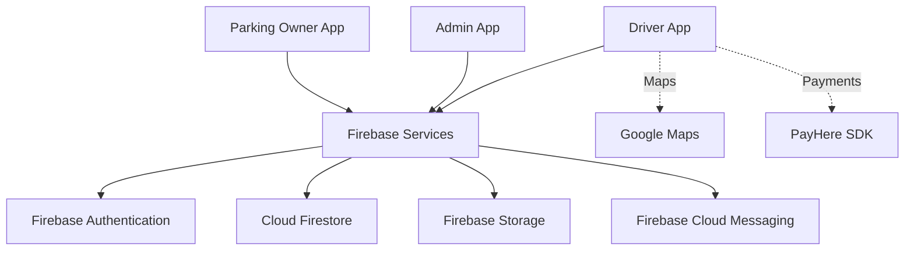

# Alphine Smart Parking System


A multi\-role **smart parking management application** developed using **Flutter** and **Firebase**\. Alphine connects drivers, parking\-space owners, and platform administrators through dedicated application experiences to make parking discovery, reservations, and management easier\.

> **Repository:** [shimarahamed/alphine_parking](https://github.com/shimarahamed/alphine_parking)

## Contents

- [Overview](#overview)
- [Key Features](#key-features)
- [System Architecture](#system-architecture)
- [Technology Stack](#technology-stack)
- [Project Structure](#project-structure)
- [Getting Started](#getting-started)
- [Configuration](#configuration)
- [Data Model](#data-model)
- [Testing](#testing)
- [Screenshots](#screenshots)
- [Roadmap](#roadmap)
- [Contributing](#contributing)
- [License](#license)

## Overview

Alphine Smart Parking aims to streamline the parking experience by providing distinct workflows for three roles:

|Role             |Primary purpose                                                                           |
|-----------------|------------------------------------------------------------------------------------------|
|**Driver / User**|Find parking locations, make bookings, access digital tickets, and review booking history.|
|**Parking Owner**|List parking locations, manage reservations, and verify tickets.                          |
|**Administrator**|Oversee users, parking owners, parking locations, and booking activity.                   |

## Key Features

### 🚗 Driver Application

- Account registration, sign\-in, and password recovery
- Browse and search parking locations
- View parking details and map locations
- Reserve parking spaces and view booking confirmations
- Access QR\-based parking tickets
- Review booking history
- Integration points for notifications and payments

### 🏢 Parking Owner Application

- Owner account access
- Add and manage parking locations
- View and manage reservations
- Scan QR codes for ticket verification

### 🛡️ Administrator Application

- Administrative dashboard
- User and parking\-owner management
- Parking\-location management
- Booking history and platform oversight

> **Implementation note:** Features and integrations listed here reflect the project’s application structure and dependencies. Some workflows may require Firebase data, platform credentials, or additional configuration before they can be used end-to-end.

## System Architecture



The codebase organizes each role into a separate Flutter module, with its own screens, models, services, and widgets\. Firebase provides shared authentication and data services\.

## Technology Stack

|Layer              |Technologies                                       |
|-------------------|---------------------------------------------------|
|Application        |Flutter, Dart                                      |
|Authentication     |Firebase Authentication                            |
|Database           |Cloud Firestore                                    |
|File storage       |Firebase Storage                                   |
|Notifications      |Firebase Cloud Messaging                           |
|Maps               |Google Maps Flutter                                |
|Ticketing          |QR code generation and barcode/QR scanning packages|
|Payment integration|PayHere Mobile SDK                                 |

## Project Structure

```text
alphine_parking/
├── lib/
│   ├── user/
│   │   ├── main.dart
│   │   ├── models/
│   │   ├── screens/
│   │   ├── services/
│   │   └── widgets/
│   ├── parkingowner/
│   │   ├── main.dart
│   │   ├── models/
│   │   ├── screens/
│   │   ├── services/
│   │   └── widgets/
│   └── admin/
│       ├── main.dart
│       ├── models/
│       ├── screens/
│       ├── services/
│       └── widgets/
├── assets/
├── android/
├── ios/
├── web/
├── test/
├── pubspec.yaml
└── README.md
```

## Getting Started

### Prerequisites

- [Flutter SDK](https://docs.flutter.dev/get-started/install) compatible with `pubspec.yaml`
- Dart SDK &#40;included with Flutter&#41;
- Android Studio or Visual Studio Code
- An Android emulator, iOS simulator, or connected device
- A configured Firebase project

### 1\. Clone the repository

```bash
git clone https://github.com/shimarahamed/alphine_parking.git
cd alphine_parking
```

### 2\. Install dependencies

```bash
flutter pub get
```

### 3\. Verify your environment

```bash
flutter doctor
```

### 4\. Configure Firebase and integrations

Follow the [Configuration](#configuration) instructions below before launching an app\.

### 5\. Run the application for your role

**Driver application**

```bash
flutter run -t lib/user/main.dart
```

**Parking owner application**

```bash
flutter run -t lib/parkingowner/main.dart
```

**Administrator application**

```bash
flutter run -t lib/admin/main.dart
```

Each command selects a different Flutter entry point within the same repository\.

## Configuration

### Firebase

1. Create a project in the [Firebase Console](https://console.firebase.google.com/)\.
2. Register the Android and/or iOS application using the platform identifiers configured in this project\.
3. Enable the Firebase services required by your chosen workflows, including **Authentication** and **Cloud Firestore**\.
4. Download and add the platform configuration files:
      
      |Platform|Configuration file                   |
      |--------|-------------------------------------|
      |Android |`android/app/google-services.json`   |
      |iOS     |`ios/Runner/GoogleService-Info.plist`|
5. Configure the Firebase platform plugins and initialization as required for your Flutter/Firebase SDK versions\.
6. Create appropriate Firestore security rules and indexes for the roles and queries used by the application\.

**Security:** Never commit service\-account private keys, PayHere merchant secrets, or other private credentials\. Client Firebase configuration files are not a substitute for proper Firestore security rules\.

### Google Maps

Configure the Google Maps API key for each target platform and enable the necessary APIs in Google Cloud\. Refer to the [Google Maps Flutter documentation](https://pub.dev/packages/google_maps_flutter) for platform\-specific setup\.

### Firebase Cloud Messaging

For push notifications, configure Firebase Cloud Messaging for each platform\. iOS notifications additionally require the relevant Apple Push Notification service &#40;APNs&#41; setup\.

### PayHere

If using the payment workflow, configure the PayHere integration according to its SDK documentation\. Keep merchant secrets and payment verification on a trusted backend rather than in client code\.

## Data Model

The project references Firestore collections for parking locations, bookings, and users\. The following is a high\-level guide; verify field names and types against the service and model code before seeding production data\.

|Collection    |Purpose                 |Example fields                                                                                             |
|--------------|------------------------|-----------------------------------------------------------------------------------------------------------|
|`ParkingSpots`|Parking location records|`name`, `address`, `price`, `latitude`, `longitude`, `facilities`, `available`                             |
|`BookingID`   |Reservation records     |`userID`, `ParkingSpotID`, `VehicleNumber`, `VehicleType`, `bookingDateTime`, `duration`, `status`, `price`|
|`UserID`      |User profiles           |`name`, `email`, `phone`, `nic`, `photoURL`, `userID`                                                      |

Use Firebase Authentication identities and server\-enforced role permissions to protect user records, bookings, and administrative operations\.

## Testing

Run the project’s automated tests:

```bash
flutter test
```

Check for Dart/Flutter analyzer issues:

```bash
flutter analyze
```

For a full functional check, test registration, parking search, booking, ticket validation, and owner/admin permissions using a dedicated Firebase test environment
